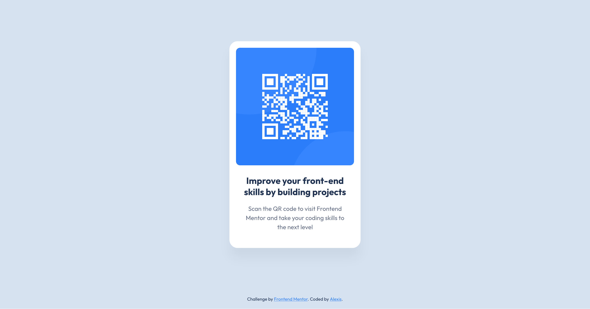

# Frontend Mentor - QR code component solution

This is a solution to the [QR code component challenge on Frontend Mentor](https://www.frontendmentor.io/challenges/qr-code-component-iux_sIO_H). Frontend Mentor challenges help you improve your coding skills by building realistic projects.

## Table of contents

- [Overview](#overview)
  - [The challenge](#the-challenge)
  - [Screenshot](#screenshot)
  - [Links](#links)
- [My process](#my-process)
  - [Built with](#built-with)
- [AI Collaboration](#ai-collaboration)
- [Author](#author)

## Overview

### The challenge

Build out this QR code component and get it looking as close to the design as possible.

### Screenshot

### Links

- Solution URL: [https://github.com/alexisborron/qr-code-component](https://github.com/alexisborron/qr-code-component)
- Live Site URL: [https://alexisborron.github.io/qr-code-component](https://alexisborron.github.io/qr-code-component)

## My process

### Built with

- Semantic HTML5 markup
- CSS custom properties
- Flexbox
- Mobile-first workflow
- BEM naming convention

### AI Collaboration

Tool: Claude (Anthropic)

How I used it: I built the QR code card myself, then asked Claude to refactor my HTML and CSS to a professional standard. It switched from element selectors to class-based ones (BEM naming), added CSS variables, and improved accessibility.

What worked well: The code is cleaner and easier to maintain, and I learned why each change mattered. Claude also caught a text contrast issue I’d missed.

What didn’t: Claude guessed the shadow values, so I corrected them using my Figma file. I learned to always check AI output against the design spec.

## Author

- Frontend Mentor - [@alexisborron](https://www.frontendmentor.io/profile/alexisborron)
